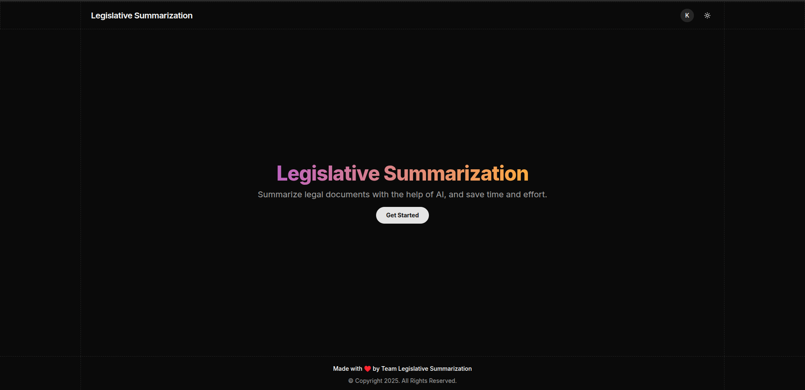
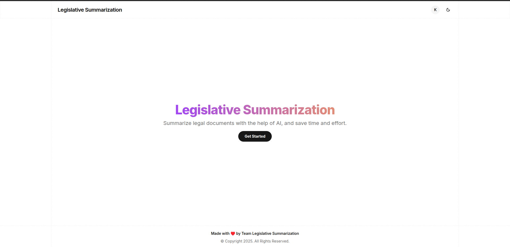
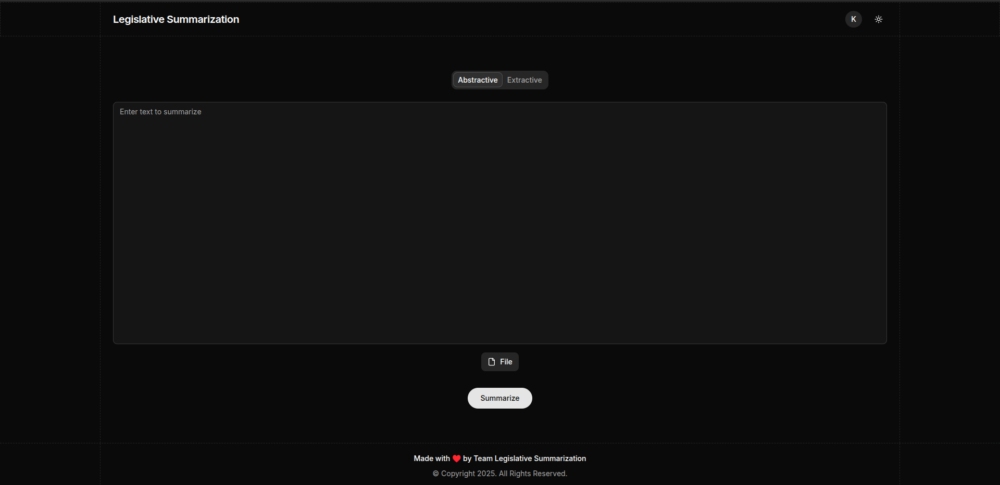
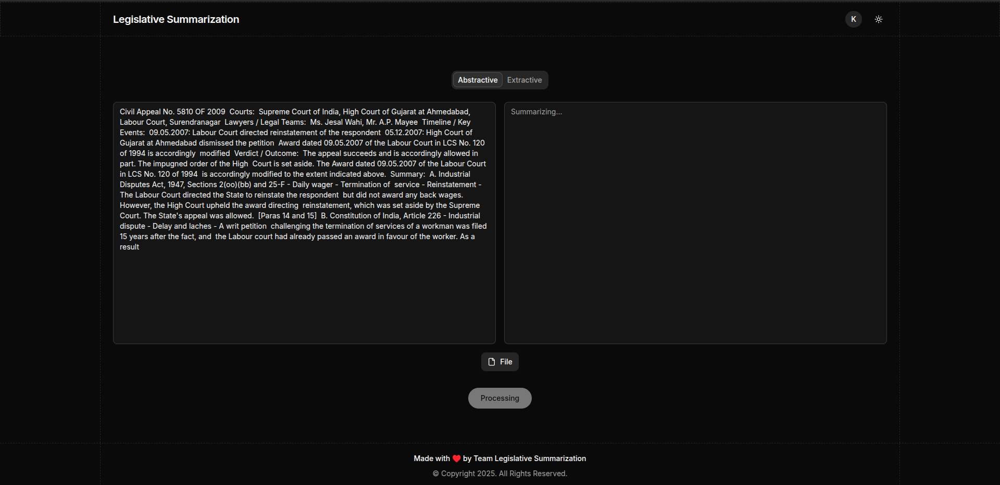
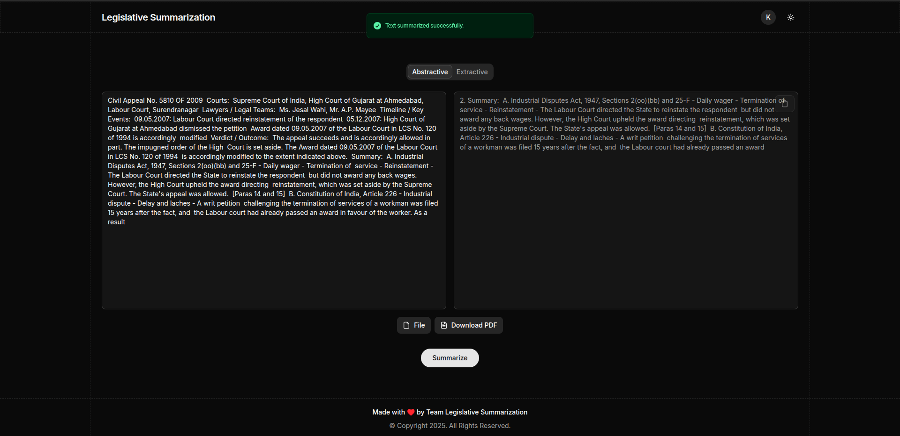

# Legislative Summarization

> **This project is archived.** I built it in college while learning web development, and it has served its purpose. It is no longer maintained, the hosted instance has been taken down, and I won't be accepting issues or pull requests. Feel free to fork it and take it further. A write-up with screenshots lives at [legislative-summarization.whyredfire.dev](https://legislative-summarization.whyredfire.dev).

Summarize legal documents with the help of AI, and save time and effort.

---

|                    Dark Theme                     |                     Light Theme                     |
| :-----------------------------------------------: | :-------------------------------------------------: |
|  |  |

## How to Use

1. **Upload** any PDF or plain‑text legal document.
2. **Choose** the desired summary length or detail level.
3. **Generate** and receive an AI‑powered summary in seconds.
4. **Export** the summary to PDF.

### Screenshots

|                Initial View                |                  Summarizing                   |               Finished Summary               |
| :----------------------------------------: | :--------------------------------------------: | :------------------------------------------: |
|  |  |  |

### Tech Stack

- **Frontend:** React + TypeScript + Tailwind
- **Backend:** Bun + Express for auth and storage, FastAPI serving the model
- **Model:** [legal-bart-summarizer](https://huggingface.co/whyredfire/legal-bart-summarizer), a BART model fine-tuned on LegalSum
- **Storage:** PostgreSQL with Prisma ORM
- **Auth:** JWT + Authenticator

## License

Released under the [MIT License](LICENSE).
